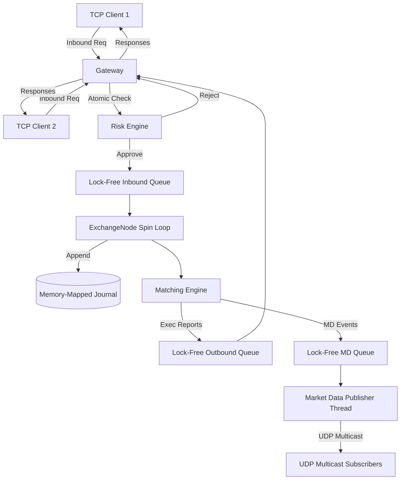

# UltraLOB - Ultra-Low-Latency Order Book Engine

UltraLOB is a high-performance, institutional-grade Limit Order Book and Matching Engine written in C++20. Designed for ultra-low latency, it employs lock-free concurrency, memory pools, atomic risk checks, and UDP multicast market data dissemination to achieve sub-microsecond matching and deterministic performance.

## Key Features

### 1. **Core Matching Engine (`MatchingEngine`, `OrderBook`)**
At the heart of UltraLOB is a single-threaded matching engine per symbol. This avoids lock contention on the hot path (similar to real exchange architectures like Nasdaq and CME).
- **Price-Time Priority (FIFO):** Uses a hybrid data structure: `std::map<Price, PriceLevel>` for price levels and intrusive doubly-linked lists (`std::list` conceptually, but implemented with raw pointers `prev`/`next` in `Order`) for O(1) order insertion and deletion.
- **O(1) Order Lookup:** A hash map maps `OrderId` to the resting `Order*` for instant cancel/modify operations.
- **Stop & Stop-Limit Orders:** Built-in support for stop orders, which trigger automatically when the Last Traded Price crosses the trigger price.

### 2. **Lock-Free Concurrency (`ExchangeNode`, `MPSCQueue`)**
- **Disruptor Pattern (Sequencer):** The matching engine thread runs a tight spin-loop, polling an inbound Multi-Producer Single-Consumer (MPSC) lock-free queue.
- **Thread Pinning:** The sequencer thread can be pinned to an isolated CPU core to ensure CPU cache warmth and prevent OS context-switching jitter.
- **Wait-Free Allocation:** Uses pre-allocated `OrderPool` and `PriceLevelPool` to ensure 0 memory allocations (`new`/`malloc`) on the hot path.

### 3. **Crash-Resilient Journaling (`Journal`)**
- **Memory-Mapped Files:** Inbound requests (Adds, Cancels, Modifies) are synchronously appended to a memory-mapped ring buffer journal before execution.
- **Deterministic Replay:** In the event of a crash, the ExchangeNode replays the journal to reconstruct the exact state of the order book and risk engine.
- **Ultra-Low Overhead:** Journal appending takes ~60-80ns per message using SIMD-accelerated memory copies and atomic cursors.

### 4. **Pre-Trade Risk Engine (`RiskEngine`)**
- **Thread-Safe Account Management:** Handles atomic buying power reservations (e.g. `held_buying_power`) to prevent naked short-selling or over-leveraging.
- **Fat-Finger Checks:** Prevents orders exceeding maximum size limits.
- **Integration:** The TCP Gateway synchronously performs Risk Checks using lock-free atomics before handing the order off to the sequencer queue.

### 5. **Market Data Dissemination (`MarketDataPublisher`)**
- **UDP Multicast:** Broadcasts incremental order book events (Add, Execute, Cancel) via UDP Multicast (simulating protocols like Nasdaq ITCH).
- **Zero-Allocation Broadcast:** The sequencer pushes market data structs to an asynchronous Publisher thread via a lock-free queue, avoiding I/O blocking on the matching engine core.

### 6. **TCP Gateway (`Gateway`)**
- Uses `asio` (standalone) for non-blocking asynchronous TCP socket handling.
- Implements a fixed-length binary wire protocol for minimum serialization overhead.

## Architecture Diagram



## How to Run

### 1. Start the Server
```bash
./build/ultralob_server.exe 8080
```
This will start the TCP Gateway on port 8080, the UDP Multicast feed on `239.255.0.1:9001`, and initialize the memory-mapped journal (`ultralob_events.journal`).

### 2. Start the Market Data Subscriber
In a separate terminal, run the python script to listen for live order book updates:
```bash
python scripts/md_client.py
```

### 3. Connect a Client & Send Orders
In a third terminal, run the python client to submit an order:
```bash
python scripts/client.py
```
You will see the `md_client.py` terminal output `ADD` and `EXEC` events as orders match on the engine!
