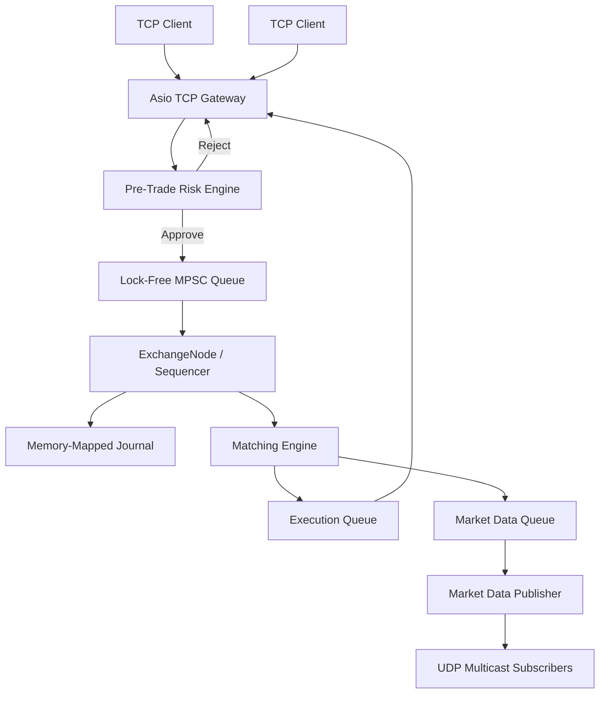

# UltraLOB

### Ultra-Low-Latency Limit Order Book & Matching Engine

UltraLOB is a high-performance, deterministic exchange-engine research project written in **C++20**. It models the core execution path of a modern electronic market: inbound order handling, pre-trade risk checks, sequencing, price-time-priority matching, journaling, execution reporting, and market-data dissemination.

The project is built around a simple systems principle:

> **Keep the critical path deterministic, allocation-free, and explicit.**

---

## System Overview

UltraLOB separates network-facing concerns from the single-threaded matching path while using lock-free queues and preallocated memory to minimize contention and runtime allocation.



---

## Core Design

### Matching Engine

The matching engine is organized as a **single-threaded execution context per symbol**, keeping the hot path free from conventional mutex contention.

- Price-time priority (FIFO)
- `std::map<Price, PriceLevel>` for price-level organization
- Intrusive order links for constant-time insertion/removal within a level
- Hash-based `OrderId → Order*` lookup for cancellation and modification
- Market, limit, stop and stop-limit order handling

### Concurrency Model

UltraLOB uses concurrency primarily at the system boundaries rather than inside the matching algorithm.

- Multi-Producer Single-Consumer lock-free queue
- Sequencer spin loop
- Optional CPU thread pinning
- Preallocated order and price-level pools
- No `new`/`malloc` allocation on the matching hot path

This architecture intentionally favors deterministic execution over unrestricted parallelism. Symbol-level partitioning provides the path toward multi-engine scaling.

### Journaling & Deterministic Recovery

Inbound requests are appended to a memory-mapped journal before execution.

The journal provides:

- Crash-resilient event persistence
- Deterministic replay
- Order-book state reconstruction
- Risk-state reconstruction
- Reproducible execution sequences

The measured journal append path is approximately **60–80 ns per message** in the current benchmark environment.

### Pre-Trade Risk

Risk validation is performed before an order enters the matching-engine queue.

Current controls include:

- Atomic buying-power reservations
- Position / leverage protection
- Maximum-order-size (fat-finger) checks
- Lock-free account-state updates

The objective is to reject invalid orders before they reach the exchange execution path rather than adding risk logic to the matching hot loop.

### Market Data

Matched and book-state events are forwarded asynchronously to a dedicated market-data publisher.

- UDP multicast dissemination
- Incremental book events
- Add / Execute / Cancel events
- Lock-free handoff from the matching engine
- No network I/O on the matching-engine thread

The design is intended to resemble the separation between an exchange's internal matching process and its downstream market-data distribution layer.

### Gateway

The network gateway uses **standalone Asio** for asynchronous TCP communication and a fixed-length binary protocol to keep serialization overhead predictable.

---

## Performance

Benchmarks are included in the repository and should be interpreted in the context of the stated test hardware and workload rather than as universal latency claims.

### Lock-Free Queue Scaling

| Producer Threads | Throughput | Latency |
|---:|---:|---:|
| 1 | ~2.98 M/s | 342 ns |
| 2 | ~2.86 M/s | 345 ns |
| 4 | ~1.86 M/s | 547 ns |
| 8 | ~1.48 M/s | 804 ns |
| 16 | ~1.60 M/s | 1160 ns |

The results illustrate the expected contention trade-off around a single consumer. UltraLOB therefore treats **symbol partitioning across independent engine instances** as the appropriate route to horizontal scaling.

### Symbol Scaling

| Active Symbols | Throughput | Latency |
|---:|---:|---:|
| 1 | ~2.78 M/s | 368 ns |
| 10 | ~3.01 M/s | 346 ns |
| 100 | ~1.68 M/s | 581 ns |
| 1,000 | ~1.77 M/s | 571 ns |
| 10,000 | ~1.56 M/s | 645 ns |

### Memory Topology

| Component | Measurement |
|---|---:|
| `sizeof(Order)` | 128 bytes |
| `sizeof(PriceLevel)` | 32 bytes |
| `OrderPool` — 1M preallocated | ~122 MB |
| Journal virtual mapping | 1 GB |
| Engine working set | ~4 MB |
| Pagefile usage | 0 MB |

**Benchmark hardware:** 8 × 1.89 GHz CPUs, 6 MiB L3 cache.

> Benchmark results are workload- and hardware-dependent. Re-run the supplied benchmarks when comparing revisions or machines.

---

## Profiling & Observability

The project includes a profiling benchmark targeting the execution-critical components:

- `OrderBook::submit()`
- `match_buy()`
- `match_sell()`

The profiler generates a Chrome Tracing-compatible JSON trace that can be inspected with `chrome://tracing` or **Perfetto**.

This makes performance investigation reproducible rather than relying only on aggregate throughput numbers.

---

## Repository Structure

```text
UltraLOB/
├── include/ultralob/      # Public engine interfaces
├── src/                   # Core implementation
├── server/                # Exchange server / gateway
├── scripts/               # Client and market-data utilities
├── tests/                 # Functional and engine tests
├── bench/                 # Performance benchmarks / profiling
├── CMakeLists.txt
├── BENCHMARKS.md
└── README.md
```

---

## Build

UltraLOB uses **CMake** and a C++20 toolchain.

```bash
git clone https://github.com/ram-mittal/UltraLOB.git
cd UltraLOB
cmake -S . -B build
cmake --build build --config Release
```

### Run the exchange server

```bash
./build/ultralob_server.exe 8080
```

The server initializes the TCP gateway, UDP market-data feed and memory-mapped journal.

### Subscribe to market data

```bash
python scripts/md_client.py
```

### Submit orders

```bash
python scripts/client.py
```

---

## Engineering Trade-offs

UltraLOB deliberately prioritizes:

**Determinism** over unrestricted parallelism  
**Preallocation** over dynamic memory convenience  
**Explicit data structures** over abstraction-heavy designs  
**Measured performance** over theoretical throughput claims  
**Reproducibility** over opaque optimization

The architecture reflects the constraints of an electronic execution system: correctness and predictable behavior remain prerequisites for low latency.

---

## Research Direction

Future work is focused on the boundary between exchange infrastructure and quantitative research:

- Multi-symbol engine partitioning
- More complete exchange matching semantics
- Hardware-aware latency measurement
- Order-flow and market-microstructure replay
- Historical market-data ingestion
- Execution-cost modelling
- Deeper latency-distribution analysis (p50 / p95 / p99 / tail latency)
- Integration with quantitative backtesting infrastructure

---

## Research Pipeline

```text
Market Data
     ↓
Market Microstructure
     ↓
Hypothesis
     ↓
Simulation / Backtest
     ↓
Statistical Validation
     ↓
Risk Analysis
     ↓
Execution Infrastructure
```

UltraLOB represents the **execution-infrastructure layer** of that pipeline.

---

## License

See the repository license for terms of use.
