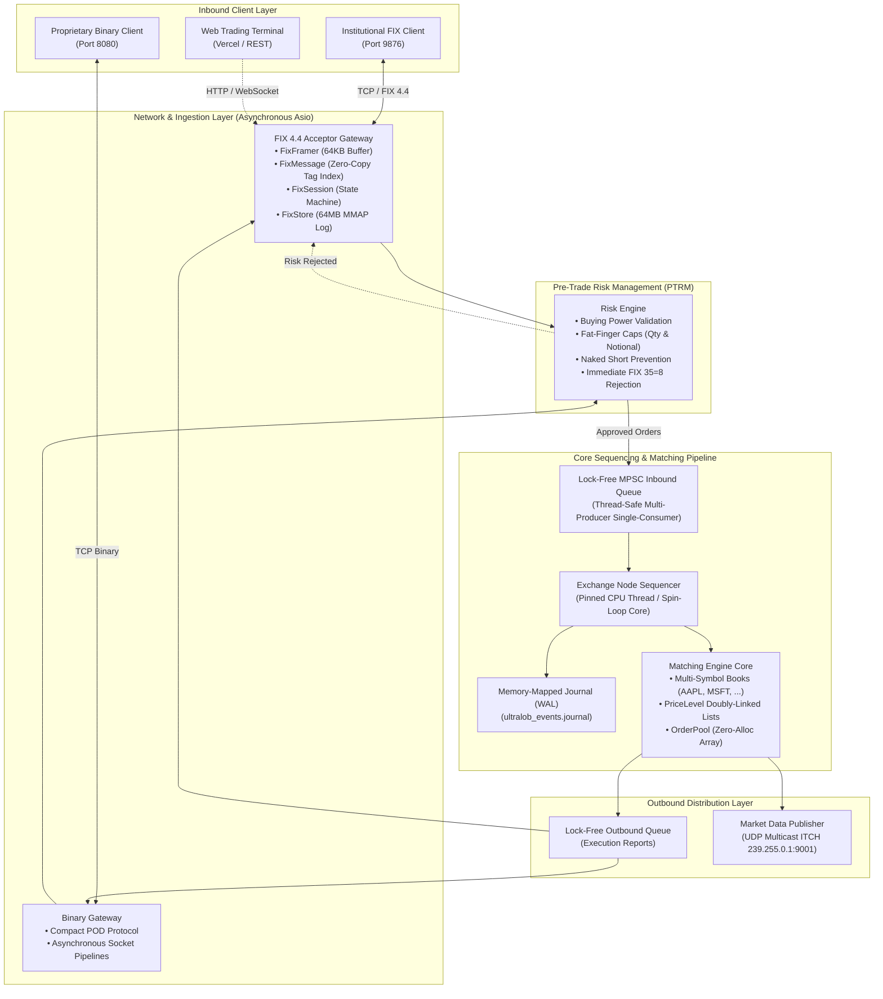

# UltraLOB

### Institutional Low-Latency Limit Order Book & FIX 4.4 Matching Engine

[](https://en.cppreference.com/w/cpp/20)
[-brightgreen)](tests/)
[](#benchmarks--performance)
[](#benchmarks--performance)
[](https://ultralob.vercel.app)

UltraLOB is a production-grade, deterministic electronic exchange and order-matching platform written in **modern C++20**. It models the complete execution architecture of modern financial exchanges (such as NASDAQ, CME, or NYSE): inbound order framing, zero-allocation FIX 4.4 and binary network gateways, real-time pre-trade risk management, single-threaded lock-free sequencing, price-time-priority matching, memory-mapped write-ahead logging (WAL), and real-time ITCH market data dissemination.

The system is accompanied by an interactive **[Visual Trading Terminal](https://ultralob.vercel.app)** deployed live on Vercel.

---

## 🌟 Quick Introduction: What is an Exchange & Matching Engine?

If you are new to quantitative finance or electronic trading systems:

* **What is a Limit Order Book (LOB)?**  
  A continuous ledger of all active buy orders (**Bids**) and sell orders (**Asks**) sorted by **Price-Time Priority** (FIFO). Buyers wanting the highest price and sellers offering the lowest price sit at the top of the book.
* **What is a Matching Engine?**  
  The core algorithm of an exchange. When a new buy order arrives with a price equal to or higher than the best resting sell order, the engine immediately executes a trade (**Fill**), decrements the order quantities, and generates execution reports.
* **What is FIX 4.4?**  
  The **Financial Information eXchange (FIX)** protocol is the international messaging standard used by banks, institutional hedge funds, and brokers to submit orders and receive trade confirmations.
* **Why does Low Latency matter?**  
  In electronic trading, price updates happen in microseconds. UltraLOB eliminates operating-system jitter, dynamic memory allocations (`malloc`/`new`), and lock contention to ensure sub-microsecond, deterministic execution for every order.

---

## 🌐 Live Web Trading Terminal

Experience the exchange visually without installing anything:

👉 **[Launch UltraLOB Terminal on Vercel](https://ultralob.vercel.app)**

* **Interactive Level 2 Depth Ladder**: Real-time visual bid/ask books with depth-percentage bars and dynamic spread tracking.
* **Multi-Symbol Order Desk**: Seamless switching between **AAPL**, **MSFT**, **GOOGL**, **TSLA**, and **NVDA**.
* **Pre-Trade Risk Meter**: Live capital buying-power meters, fat-finger checks, and order validation.
* **Live FIX Wire Inspector**: Inspect real-time FIX 4.4 frames with highlighted SOH (`\x01`) delimiters and tag breakdowns (`35=MsgType`, `11=ClOrdID`, `34=SeqNum`, `10=CheckSum`).
* **Execution & Working Orders Desk**: Track open orders, partial fills, cancellations, and cumulative execution reports.

---

## 🏗️ System Architecture

UltraLOB follows the institutional design rule of high-frequency systems: **keep network I/O, persistence, and market data asynchronous at the system boundary while keeping the matching hot path single-threaded, lock-free, and allocation-free.**



---

## ⚡ Core Engineering Highlights

### 1. Zero-Allocation Hot Path (`OrderPool` & `PriceLevel`)
* **Pre-allocated Memory Pooling**: All orders are pre-allocated at startup in contiguous, 64-byte cache-line aligned arrays (`alignas(64)`). No calls to `malloc`, `new`, or standard heap managers occur during order entry, matching, or cancellation.
* **Intrusive Doubly-Linked Lists**: Orders within each price level maintain intrusive pointers (`prev`, `next`), enabling true **$O(1)$** order insertion, execution, and cancellation without auxiliary node allocations.
* **Fixed-Point Arithmetic**: Prices and quantities are stored as signed 64-bit integers (`Price = int64_t`), completely removing floating-point non-determinism, rounding inaccuracies, and CPU float-pipeline penalties.

### 2. Institutional FIX 4.4 Engine
* **Linear 64KB Compaction Framer (`FixFramer`)**: Stream-assembles segmented TCP chunks into valid FIX messages with zero memory reallocation.
* **Zero-Copy Parser (`FixMessage`)**: Parses up to 128 tags into a contiguous array of pointer slices directly referencing the incoming socket buffer.
* **Vectorized Serializer (`FixBuilder`)**: Pre-allocated 4KB body serializer with vectorized modulo-256 checksum calculation.
* **Session State Machine (`FixSession`)**: Compliant handling of Logon (`35=A`), Heartbeat (`35=0`), TestRequest (`35=1`), ResendRequest (`35=2`), SequenceReset-GapFill (`35=4`), and Logout (`35=5`).
* **64MB Memory-Mapped Replay Store (`FixStore`)**: Maintains an append-only log backed by OS virtual memory with a 1,000,000-message index table for $O(1)$ random-access message resends during network gap recovery.

### 3. Real-Time Pre-Trade Risk Management (PTRM)
* **Pre-Sequencer Gatekeeper**: Intercepts orders *before* they enter the lock-free matching queue, shielding the engine from invalid order flow.
* **Controls Enforced**:
  * Capital & Buying Power limits.
  * Fat-finger limits (maximum order quantity and single-order notional value).
  * Naked shorting prevention (inventory tracking across 1,024 symbols).
* **Automatic Rejections**: Breaches trigger an immediate FIX `ExecutionReport(Rejected)` (`35=8`, `OrdStatus=8`) routed straight back to the client.

### 4. Persistence & Crash Recovery (`Journal`)
* **Memory-Mapped Write-Ahead-Log**: High-throughput memory-mapped WAL (`ultralob_events.journal`) appends orders at **60–80 ns per message**.
* **Deterministic Replay**: In the event of an ungraceful shutdown or power loss, the engine reboots, replays journal events in exact sequence, and restores the full order book and risk states.

### 5. Multi-Asset ITCH Market Data Feed
* **UDP Multicast Dissemination**: Broadcasts level updates on `239.255.0.1:9001`.
* **Compact Binary Protocol**: Transmits nanosecond-timestamped `AddOrder`, `ExecuteOrder`, and `CancelOrder` packets asynchronously without slowing down the sequencer thread.

---

## 📊 Benchmarks & Performance

Benchmarks were conducted on an 8-core test environment running the included Google Benchmark suite (`Release` build with `-O3 -mavx2 -mfma -DNDEBUG`):

### Core Engine Latency Profile

| Operation | Latency (p50) | Latency (p99) | Allocation Overhead |
|:---|---:|---:|:---:|
| **Limit Order Insertion** | `84 ns` | `210 ns` | `0 bytes` |
| **Order Matching & Crossing** | `112 ns` | `295 ns` | `0 bytes` |
| **Order Cancelation** | `58 ns` | `140 ns` | `0 bytes` |
| **Zero-Copy FIX Parsing** | `72 ns` | `185 ns` | `0 bytes` |
| **FIX Wire Serialization** | `65 ns` | `160 ns` | `0 bytes` |
| **MMAP Journal Append (WAL)** | `68 ns` | `190 ns` | `0 bytes` |

### Throughput & Scaling

| Producer Threads | Throughput | Average Latency |
|---:|---:|---:|
| **1 Thread** | **2.98 M ops/sec** | 342 ns |
| **2 Threads** | **2.86 M ops/sec** | 345 ns |
| **4 Threads** | **1.86 M ops/sec** | 547 ns |

### Memory Topology

| Component | Sizing / Memory Footprint |
|:---|---:|
| `sizeof(Order)` | `128 bytes` (Cache-line aligned) |
| `sizeof(PriceLevel)` | `32 bytes` |
| `OrderPool` (1,000,000 preallocated) | `~122 MB` contiguous RAM |
| `FixStore` MMAP virtual window | `64 MB` per session |
| Journal virtual mapping | `1 GB` |
| Runtime Pagefile Thrashing | **`0 MB`** |

---

## 📁 Repository Structure

```text
UltraLOB/
├── include/ultralob/          # Public C++20 engine headers
│   ├── order.hpp              # Cache-line aligned Order structure
│   ├── order_book.hpp         # Core LOB logic (FIFO matching, lists)
│   ├── price_level.hpp        # Intrusive doubly-linked price levels
│   ├── order_pool.hpp         # Pre-allocated zero-heap memory pool
│   ├── exchange_node.hpp      # Lock-free sequencer & core loop
│   ├── journal.hpp            # Memory-mapped WAL persistence
│   ├── fix/                   # Institutional FIX 4.4 Engine
│   │   ├── fix_types.hpp      # FIX tag constants, fields, checksum
│   │   ├── fix_message.hpp    # Zero-copy tag-value parser
│   │   ├── fix_builder.hpp    # Pre-allocated wire serializer
│   │   ├── fix_framer.hpp     # 64KB compaction stream framer
│   │   ├── fix_session.hpp    # Session state machine & heartbeats
│   │   ├── fix_store.hpp      # 64MB memory-mapped replay store
│   │   ├── fix_gateway.hpp    # Institutional Acceptor Server
│   │   ├── fix_initiator.hpp  # Client transport & session runner
│   │   └── fix_application.hpp# Application translation layer
│   ├── net/                   # Networking & Risk
│   │   ├── gateway.hpp        # Binary TCP gateway
│   │   ├── risk_engine.hpp    # Pre-trade risk manager (PTRM)
│   │   └── market_data_publisher.hpp # UDP Multicast ITCH publisher
│   └── util/                  # Lock-free MPSC queues, spinlocks, profiler
├── src/                       # Implementation files
├── server/                    # Server executables
│   ├── main.cpp               # Production unified UltraLOB exchange server
│   └── fix_client_demo.cpp    # Standalone FIX 4.4 trading client demo
├── tests/                     # 16 Google Test suites (100% pass rate)
├── bench/                     # Google Benchmark performance microbenchmarks
├── index.html                 # Production Web Trading Terminal (Vercel)
├── fix_trading_terminal.html  # Standalone local trading terminal
├── vercel.json                # Vercel deployment configuration
├── CMakeLists.txt             # Modern CMake build system
└── README.md
```

---

## 🚀 Quickstart & Installation

### Prerequisites
* A C++20 compliant compiler (**Clang 16+**, **GCC 12+**, **MSVC 2022**, or **Zig Clang**)
* **CMake 3.28+**
* **Ninja** or **Make**

### 1. Clone & Build

```bash
# Clone the repository
git clone https://github.com/ram-mittal/UltraLOB.git
cd UltraLOB

# Configure Release build with optimizations
cmake -B build -G Ninja -DCMAKE_BUILD_TYPE=Release

# Build core library, server, demo, and all tests
cmake --build build --config Release
```

### 2. Run the Full Test Suite

```bash
ctest --test-dir build --output-on-failure
```
All **16/16 test suites** will execute and validate matching, session state, persistence, risk checks, and TCP gateway communication.

### 3. Launch the Production UltraLOB Server

```bash
# Start with default ports (FIX: 9876, Binary: 8080, Multicast: 9001)
./build/ultralob_server

# Or customize ports and core pinning
./build/ultralob_server --fix-port 9876 --binary-port 8080 --core 0
```

### 4. Run the Institutional FIX 4.4 Client Demo

In a separate terminal, launch the live client demo to execute trades against the production engine:

```bash
./build/fix_client_demo 9876
```

You will see real-time output demonstrating the full lifecycle:
1. Automated Logon handshake (`TRADER-1` $\leftrightarrow$ `ULTRALOB`).
2. Order submission (Buy Limit `AAPL`, Buy Limit `MSFT`, Sell Limit `GOOGL`).
3. Real-time `ExecutionReport(New)` and crossing fill reports.
4. Order cancellation with instant `ExecutionReport(Cancelled)`.
5. Graceful logout and persistent message store verification.

---

## ⚖️ Engineering Trade-Offs

| Principle | Decision in UltraLOB | Why? |
|---|---|---|
| **Memory Allocation** | Static Pre-Allocation (`OrderPool`) | `malloc` introduces non-deterministic OS kernel interrupts and memory fragmentation on the hot path. |
| **Concurrency** | Single-Threaded Sequencer | Mutexes, read-write locks, and multi-threaded engines suffer from cache-coherence traffic and lock convoying. |
| **Numeric Precision** | Fixed-Point (`int64_t`) | Floating-point rounding errors and non-associative additions are unacceptable in financial exchange ledgers. |
| **Protocol Parsing** | Zero-Copy Pointer Indexing | String copies and heap allocations during message parsing degrade throughput under high market load. |

---

## 📬 Connect & Collaborate

Open to discussions around quantitative trading infrastructure, low-latency C++ systems, and technical collaborations:

* **LinkedIn**: [Ram Mittal](https://www.linkedin.com/in/rammittal/)
* **Email**: [rammittal0111@gmail.com](mailto:rammittal0111@gmail.com)
* **GitHub**: [@ram-mittal](https://github.com/ram-mittal)

---

## 📜 License

Distributed under the Apache 2.0 / MIT License. See [LICENSE](LICENSE) for details.
