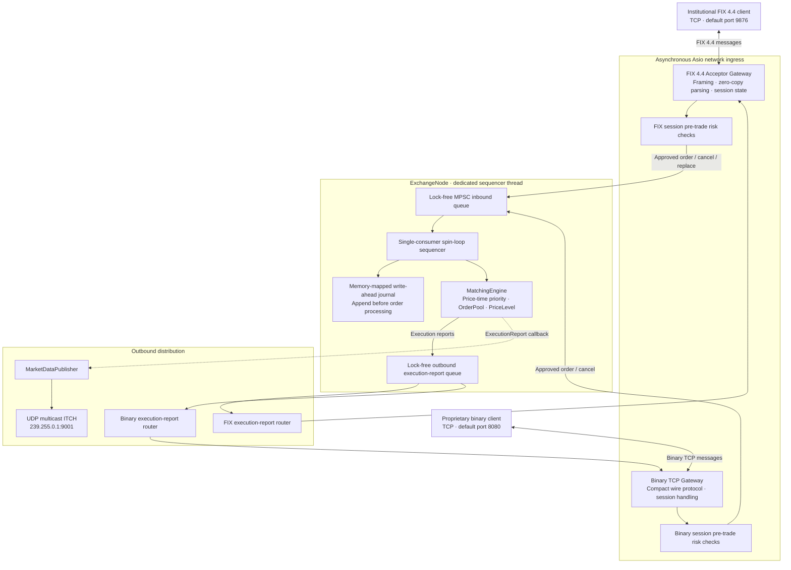
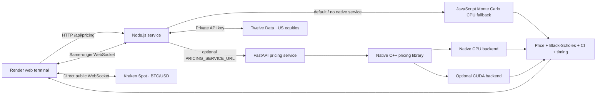

# UltraLOB

### Institutional Low-Latency Limit Order Book & FIX 4.4 Matching Engine

[](https://en.cppreference.com/w/cpp/20)
[-brightgreen)](tests/)
[](#benchmarks--performance)
[](#benchmarks--performance)
[](https://ultralob.onrender.com)

UltraLOB is a production-grade, deterministic electronic exchange and order-matching platform written in **modern C++20**. It models the complete execution architecture of modern financial exchanges (such as NASDAQ, CME, or NYSE): inbound order framing, zero-allocation FIX 4.4 and binary network gateways, real-time pre-trade risk management, single-threaded lock-free sequencing, price-time-priority matching, memory-mapped write-ahead logging (WAL), and real-time ITCH market data dissemination.

The system is accompanied by an interactive **[Visual Trading Terminal](https://ultralob.onrender.com)** deployed on Render. The hosted application combines a direct browser-to-Kraken BTC/USD feed, an optional server-side Twelve Data equity feed, and a Monte Carlo pricing workbench.

---

## 🌟 Quick Introduction: What is an Exchange & Matching Engine?

If you are new to quantitative finance or electronic trading systems:

* **What is a Limit Order Book (LOB)?**  
  A continuous ledger of all active buy orders (**Bids**) and sell orders (**Asks**) sorted by **Price-Time Priority** (FIFO). Buyers wanting the highest price and sellers offering the lowest price sit at the top of the book.
* **What is a Matching Engine?**  
  The core algorithm of an exchange. When a new buy order arrives with a price equal to or higher than the best resting sell order, the engine immediately executes a trade (**Fill**), decrements the order quantities, and generates execution reports.
* **What is FIX 4.4?**  
  The **Financial Information eXchange (FIX)** protocol is the international messaging standard used by banks, institutional hedge funds, and brokers to submit orders and receive trade confirmations.
* **Why does Low Latency matter?**  
  In electronic trading, price updates happen in microseconds. UltraLOB eliminates operating-system jitter, dynamic memory allocations (`malloc`/`new`), and lock contention to ensure sub-microsecond, deterministic execution for every order.

---

## 🌐 Live Web Trading Terminal

Experience the web terminal without installing anything:

👉 **[Launch UltraLOB on Render](https://ultralob.onrender.com)**

* **BTC/USD live market data**: Browser-direct Kraken Spot WebSocket v2 ticker/trade and best-bid/ask stream; public access requires no API key.
* **Automated Monte Carlo repricing**: Live BTC spot can update the pricing input and trigger European call/put repricing on a configurable interval.
* **Optional US equity feed**: AAPL, MSFT and GOOGL use Twelve Data through a server-side WebSocket gateway when the key and account entitlements are configured.
* **Pricing analytics**: Risk-neutral GBM Monte Carlo, antithetic variates, Black–Scholes reference values, standard errors and 95% confidence intervals.
* **Trading-system interface**: Order desk, simulated Level 2 books, FIX 4.4 wire inspector, working orders and execution blotter.
* **MT5 demo execution bridge (phase 1)**: authenticated per-connector tokens, account/position heartbeats, server-side risk sizing and demo-only order instructions. The EA is off by default and refuses live/contest accounts.

**Execution disclaimer:** the web terminal's FIX order ticket and sample fills are simulated. It does not route orders to a live broker or exchange. BTC shows live best bid/ask, not full market depth; the displayed equity Level 2 books are demo data.

---

## 🏗️ System Architecture

UltraLOB is composed of **two separate runtime systems**:

1. The hosted **web application** on Render, which serves the dashboard, market-data interfaces and Monte Carlo pricing API.
2. The standalone **C++ exchange engine**, which accepts FIX 4.4 and binary TCP clients, applies pre-trade risk checks, sequences orders, journals requests, matches orders and publishes execution/market-data events.

They are separate deployables. The current Render web terminal does **not** submit its simulated FIX ticket orders to the standalone C++ matching engine.

### Hosted web application and quantitative pricing

```mermaid
flowchart TB
    subgraph Browser["Browser · UltraLOB web terminal"]
        UI["Trading dashboard and pricing workbench"]
        SIM["FIX order ticket and sample fills<br/>SIMULATED"]
    end

    subgraph Render["Render Free · one persistent Node.js service"]
        APP["server.js<br/>Serves index.html and /healthz"]
        PRICE["POST /api/pricing"]
        MDGW["/api/market-data<br/>HTTP health + equity WebSocket gateway"]
        HISTORY["/api/market-history<br/>Cached historical candle API"]
        EXEC["/api/execution<br/>MT5 demo execution API"]
        CPUJS["Built-in JavaScript Monte Carlo CPU fallback<br/>Default AUTO / CPU path"]
    end

    KRAKEN["Kraken Spot WebSocket v2<br/>BTC/USD ticker + trade"]
    KRAKEN_REST["Kraken Spot public OHLC REST<br/>BTC/USD"]
    TWELVE["Twelve Data WebSocket<br/>AAPL · MSFT · GOOGL"]
    TWELVE_REST["Twelve Data time_series REST<br/>AAPL · MSFT · GOOGL"]
    DB[("PostgreSQL<br/>Connector, signal, command and audit state")]
    MT5EA["UltraLOB Bridge EA<br/>MQL5 · HTTPS poll / heartbeat / ack"]
    MT5["MT5 terminal · demo account"]
    DEMOBROKER["Broker trade server<br/>DEMO ONLY"]
    SIGNALS["Strategy signal producer<br/>Admin-authenticated API ingress"]
    
    subgraph OptionalPricing["Optional separately hosted native pricing service"]
        FASTAPI["FastAPI pricing API"]
        CPP["Native C++ shared pricing library"]
        NATIVECPU["Native CPU backend"]
        CUDA["Optional CUDA / CURAND backend<br/>NVIDIA GPU host"]
    end

    UI -->|"HTTPS · dashboard and pricing inputs"| APP
    APP --> PRICE
    APP --> MDGW
    APP --> HISTORY
    APP --> EXEC
    SIGNALS -->|"POST /signals · admin key"| EXEC
    EXEC <--> DB
    MT5EA <-->|"HTTPS WebRequest · 5s poll"| EXEC
    MT5EA <--> MT5
    MT5 <-->|"OrderCheck / OrderSend · demo only"| DEMOBROKER
    UI <-->|"WSS · live BTC/USD trades and best bid/ask"| KRAKEN
    UI <-->|"WSS · equity subscription and ticks"| MDGW
    MDGW <-->|"Private upstream WebSocket<br/>API key stays server-side"| TWELVE
    UI <-->|"HTTPS · historical candles for scenario lab"| HISTORY
    HISTORY -->|"Public OHLC · no key"| KRAKEN_REST
    HISTORY -->|"Private time_series request"| TWELVE_REST

    PRICE -->|"Default when no native service is configured"| CPUJS
    PRICE -->|"Optional PRICING_SERVICE_URL"| FASTAPI
    FASTAPI --> CPP
    CPP --> NATIVECPU
    CPP --> CUDA
    CPUJS -->|"Call / put prices · CI · timing"| UI
    NATIVECPU -->|"Call / put prices · CI · timing"| UI
    CUDA -->|"Call / put prices · CI · timing"| UI

    UI -.-> SIM
```



**Web pricing flow:** the browser posts model inputs to the same-origin `/api/pricing` route. The built-in JavaScript CPU fallback is the default, so Monte Carlo pricing does not need a separate pricing server. When `PRICING_SERVICE_URL` is configured, the Node API can forward requests to the optional FastAPI service and its native C++ library. CUDA requires a separate NVIDIA GPU host; the Render Free instance does not provide one.

**Market-data flow:** BTC/USD connects directly from the browser to Kraken's public WebSocket v2 endpoints; the BTC stream does not pass through Render. The application keeps `BTCUSDT` as an internal UI key but labels the actual Kraken market as BTC/USD. AAPL/MSFT/GOOGL use the Render-hosted equity gateway, which connects to Twelve Data with `TWELVE_DATA_API_KEY` stored server-side. The separate `/api/market-history` endpoint retrieves Kraken public OHLC candles for BTC/USD and Twelve Data time-series candles for equities, with short server-side caching. The Market Monte Carlo scenario lab calibrates historical return blocks from completed candles; a fresh live quote can anchor the simulated entry price. The option-pricing Auto Monte Carlo separately waits for a live quote, synchronizes spot when enabled, and reprices using the selected interval. Other contract inputs remain user assumptions.

### MT5 demo execution bridge — phase 1

The first broker integration is a **single-operator MT5 demo connector**, not yet a self-service copy-trading product. An operator creates a connector through an admin-key-protected API and receives a one-time bearer token. The token hash is stored in PostgreSQL. The MT5 EA reports account, open-position and symbol-contract snapshots; the Execution API sizes each signal against the follower's own equity and broker tick/volume rules. The EA rechecks the order locally with `OrderCalcProfit` and `OrderCheck` before `OrderSend`.

The connector is deliberately demo-only: it refuses real/contest accounts, connector creation only accepts `environment: DEMO`, and the execution health endpoint reports `live_execution_enabled: false`. The EA's `Enable Demo Execution` input defaults to false. It polls with MQL5 `WebRequest` on a timer, so this first transport is for lower-frequency copy execution rather than tick-level/HFT routing.

See [MT5 Demo Bridge setup](docs/MT5_DEMO_BRIDGE.md) for PostgreSQL configuration, connector pairing, EA installation and a controlled test signal. The API does not yet have user login/self-service account management, Exness integration, multi-strategy marketplace, billing or automated Monte Carlo-to-signal logic. The current web terminal's FIX order ticket remains a separate UI simulation.

### Standalone C++ exchange and matching engine



**Matching-engine flow:** the FIX and binary gateways validate inbound requests before submitting them to the lock-free MPSC queue. The dedicated ExchangeNode thread journals each request before applying it to the matching engine. Execution reports are placed on the outbound queue and routed back through the gateway sessions. The ExchangeNode execution-report callback also feeds the UDP multicast ITCH publisher.

The hosted web terminal is not currently wired to this native exchange path. Its order ticket, order submissions, working-order display and sample fills are a UI simulation; only its market-data and Monte Carlo pricing paths are live integrations.
---

## ⚡ Core Engineering Highlights

### 1. Zero-Allocation Hot Path (`OrderPool` & `PriceLevel`)
* **Pre-allocated Memory Pooling**: All orders are pre-allocated at startup in contiguous, 64-byte cache-line aligned arrays (`alignas(64)`). No calls to `malloc`, `new`, or standard heap managers occur during order entry, matching, or cancellation.
* **Intrusive Doubly-Linked Lists**: Orders within each price level maintain intrusive pointers (`prev`, `next`), enabling true **$O(1)$** order insertion, execution, and cancellation without auxiliary node allocations.
* **Fixed-Point Arithmetic**: Prices and quantities are stored as signed 64-bit integers (`Price = int64_t`), completely removing floating-point non-determinism, rounding inaccuracies, and CPU float-pipeline penalties.

### 2. Institutional FIX 4.4 Engine
* **Linear 64KB Compaction Framer (`FixFramer`)**: Stream-assembles segmented TCP chunks into valid FIX messages with zero memory reallocation.
* **Zero-Copy Parser (`FixMessage`)**: Parses up to 128 tags into a contiguous array of pointer slices directly referencing the incoming socket buffer.
* **Vectorized Serializer (`FixBuilder`)**: Pre-allocated 4KB body serializer with vectorized modulo-256 checksum calculation.
* **Session State Machine (`FixSession`)**: Compliant handling of Logon (`35=A`), Heartbeat (`35=0`), TestRequest (`35=1`), ResendRequest (`35=2`), SequenceReset-GapFill (`35=4`), and Logout (`35=5`).
* **64MB Memory-Mapped Replay Store (`FixStore`)**: Maintains an append-only log backed by OS virtual memory with a 1,000,000-message index table for $O(1)$ random-access message resends during network gap recovery.

### 3. Real-Time Pre-Trade Risk Management (PTRM)
* **Pre-Sequencer Gatekeeper**: Intercepts orders *before* they enter the lock-free matching queue, shielding the engine from invalid order flow.
* **Controls Enforced**:
  * Capital & Buying Power limits.
  * Fat-finger limits (maximum order quantity and single-order notional value).
  * Naked shorting prevention (inventory tracking across 1,024 symbols).
* **Automatic Rejections**: Breaches trigger an immediate FIX `ExecutionReport(Rejected)` (`35=8`, `OrdStatus=8`) routed straight back to the client.

### 4. Persistence & Crash Recovery (`Journal`)
* **Memory-Mapped Write-Ahead-Log**: High-throughput memory-mapped WAL (`ultralob_events.journal`) appends orders at **60–80 ns per message**.
* **Deterministic Replay**: In the event of an ungraceful shutdown or power loss, the engine reboots, replays journal events in exact sequence, and restores the full order book and risk states.

### 5. Multi-Asset ITCH Market Data Feed
* **UDP Multicast Dissemination**: Broadcasts level updates on `239.255.0.1:9001`.
* **Compact Binary Protocol**: Transmits nanosecond-timestamped `AddOrder`, `ExecuteOrder`, and `CancelOrder` packets asynchronously without slowing down the sequencer thread.

---

## 📊 Benchmarks & Performance

Benchmarks were conducted on an 8-core test environment running the included Google Benchmark suite (`Release` build with `-O3 -mavx2 -mfma -DNDEBUG`):

### Core Engine Latency Profile

| Operation | Latency (p50) | Latency (p99) | Allocation Overhead |
|:---|---:|---:|:---:|
| **Limit Order Insertion** | `84 ns` | `210 ns` | `0 bytes` |
| **Order Matching & Crossing** | `112 ns` | `295 ns` | `0 bytes` |
| **Order Cancelation** | `58 ns` | `140 ns` | `0 bytes` |
| **Zero-Copy FIX Parsing** | `72 ns` | `185 ns` | `0 bytes` |
| **FIX Wire Serialization** | `65 ns` | `160 ns` | `0 bytes` |
| **MMAP Journal Append (WAL)** | `68 ns` | `190 ns` | `0 bytes` |

### Throughput & Scaling

| Producer Threads | Throughput | Average Latency |
|---:|---:|---:|
| **1 Thread** | **2.98 M ops/sec** | 342 ns |
| **2 Threads** | **2.86 M ops/sec** | 345 ns |
| **4 Threads** | **1.86 M ops/sec** | 547 ns |

### Memory Topology

| Component | Sizing / Memory Footprint |
|:---|---:|
| `sizeof(Order)` | `128 bytes` (Cache-line aligned) |
| `sizeof(PriceLevel)` | `32 bytes` |
| `OrderPool` (1,000,000 preallocated) | `~122 MB` contiguous RAM |
| `FixStore` MMAP virtual window | `64 MB` per session |
| Journal virtual mapping | `1 GB` |
| Runtime Pagefile Thrashing | **`0 MB`** |

---

## 📁 Repository Structure

```text
UltraLOB/
├── include/ultralob/          # Public C++20 engine headers
│   ├── order.hpp              # Cache-line aligned Order structure
│   ├── order_book.hpp         # Core LOB logic (FIFO matching, lists)
│   ├── price_level.hpp        # Intrusive doubly-linked price levels
│   ├── order_pool.hpp         # Pre-allocated zero-heap memory pool
│   ├── exchange_node.hpp      # Lock-free sequencer & core loop
│   ├── journal.hpp            # Memory-mapped WAL persistence
│   ├── fix/                   # Institutional FIX 4.4 Engine
│   │   ├── fix_types.hpp      # FIX tag constants, fields, checksum
│   │   ├── fix_message.hpp    # Zero-copy tag-value parser
│   │   ├── fix_builder.hpp    # Pre-allocated wire serializer
│   │   ├── fix_framer.hpp     # 64KB compaction stream framer
│   │   ├── fix_session.hpp    # Session state machine & heartbeats
│   │   ├── fix_store.hpp      # 64MB memory-mapped replay store
│   │   ├── fix_gateway.hpp    # Institutional Acceptor Server
│   │   ├── fix_initiator.hpp  # Client transport & session runner
│   │   └── fix_application.hpp# Application translation layer
│   ├── quant/                 # Public Monte Carlo pricing API
│   ├── net/                   # Networking & Risk
│   │   ├── gateway.hpp        # Binary TCP gateway
│   │   ├── risk_engine.hpp    # Pre-trade risk manager (PTRM)
│   │   └── market_data_publisher.hpp # UDP Multicast ITCH publisher
│   └── util/                  # Lock-free MPSC queues, spinlocks, profiler
├── src/                       # Implementation files
├── server/                    # Server executables
│   ├── main.cpp               # Production unified UltraLOB exchange server
│   ├── monte_carlo_demo.cpp   # Standalone option pricer CLI
│   └── fix_client_demo.cpp    # Standalone FIX 4.4 trading client demo
├── tests/                     # 16 Google Test suites (100% pass rate)
├── bench/                     # Google Benchmark performance microbenchmarks
├── docs/MONTE_CARLO.md        # Monte Carlo model and build guide
├── api/pricing.js             # Monte Carlo API + bounded JavaScript CPU fallback
├── api/market-data.js         # Twelve Data equity WebSocket gateway + HTTP health route
├── api/market-history.js      # Historical OHLC candles for Monte Carlo scenarios
├── lib/market-data.js         # Market symbol validation and provider message normalizers
├── pricing_service/           # FastAPI + native C++ CPU/CUDA pricing service
├── server.js                  # Persistent Node entrypoint for Render
├── render.yaml                # Render Blueprint (Free service plan)
├── index.html                 # Web Trading Terminal (Render / Vercel)
├── fix_trading_terminal.html  # Standalone local trading terminal
├── docs/DEPLOY_RENDER_FREE.md # Render setup, market-data and pricing notes
├── docs/MT5_DEMO_BRIDGE.md    # MT5 demo connector installation and operation
├── execution/                 # Execution API, PostgreSQL store and pre-trade risk checks
├── mt5/Experts/               # MT5 demo-only Bridge EA source
├── vercel.json                # Optional Vercel deployment configuration
├── CMakeLists.txt             # Modern CMake build system
└── README.md
```

---

## 🚀 Quickstart & Installation

### Prerequisites
* A C++20 compliant compiler (**Clang 16+**, **GCC 12+**, **MSVC 2022**, or **Zig Clang**)
* **CMake 3.28+**
* **Ninja** or **Make**

### 1. Clone & Build

```bash
# Clone the repository
git clone https://github.com/ram-mittal/UltraLOB.git
cd UltraLOB

# Configure Release build with optimizations
cmake -B build -G Ninja -DCMAKE_BUILD_TYPE=Release

# Build core library, server, demo, and all tests
cmake --build build --config Release
```

### 2. Run the Full Test Suite

```bash
ctest --test-dir build --output-on-failure
```
All **16/16 test suites** will execute and validate matching, session state, persistence, risk checks, and TCP gateway communication.

### 3. Launch the Production UltraLOB Server

```bash
# Start with default ports (FIX: 9876, Binary: 8080, Multicast: 9001)
./build/ultralob_server

# Or customize ports and core pinning
./build/ultralob_server --fix-port 9876 --binary-port 8080 --core 0
```

### 4. Run the Institutional FIX 4.4 Client Demo

In a separate terminal, launch the live client demo to execute trades against the production engine:

```bash
./build/fix_client_demo 9876
```

You will see real-time output demonstrating the full lifecycle:
1. Automated Logon handshake (`TRADER-1` $\leftrightarrow$ `ULTRALOB`).
2. Order submission (Buy Limit `AAPL`, Buy Limit `MSFT`, Sell Limit `GOOGL`).
3. Real-time `ExecutionReport(New)` and crossing fill reports.
4. Order cancellation with instant `ExecutionReport(Cancelled)`.
5. Graceful logout and persistent message store verification.

---

## Monte Carlo Option Pricing

The trading terminal includes a **Monte Carlo Option Pricing** workbench for European vanilla calls and puts. It supports editable contract inputs, AUTO/CPU/NVIDIA CUDA backend selection, Black–Scholes reference prices, standard errors, 95% confidence intervals, path throughput, and a CPU-versus-GPU comparison action.

The web deployment runs a bounded JavaScript CPU fallback in the Node.js service by default, so the pricing workbench can operate without a separate GPU host. The optional FastAPI service loads the native C++ pricing library and can expose CPU or CUDA execution when deployed on suitable infrastructure. Pricing work is separate from the matching engine's single-threaded sequencer. On the Render Free deployment, CUDA is not included; selecting CUDA returns an explicit unavailable response rather than silently substituting CPU.

### Pricing inputs

| Frontend field / CLI flag | Meaning | Default | Validation |
|---|---|---:|---|
| Spot / `--spot` | Current underlying price, S₀ | `100` | Finite and positive |
| Strike / `--strike` | Option strike, K | `100` | Finite and positive |
| Risk-free rate / `--rate` | Continuously compounded annual rate, r | `0.05` | Decimal between -1 and 1 |
| Dividend / `--dividend` | Continuous annual dividend yield, q | `0.00` | Decimal between -1 and 1 |
| Volatility / `--vol` | Annualized volatility, σ | `0.20` | Decimal from 0 to 5; 0.20 = 20% |
| Maturity / `--maturity` | Time to expiry, T | `1.0` | Years, greater than zero |
| Paths / `--paths` | Total simulated terminal-price paths | `1,000,000` | Even integer from 4 to 50,000,000 |
| Seed / `--seed` | Random-number seed | `42` | Non-negative safe integer in the web UI |
| Backend / `--backend` | `auto`, `cpu`, or `cuda` | `auto` | CUDA requires a CUDA build and an accessible NVIDIA GPU |

Each antithetic pair contributes one independent observation to the standard-error calculation, so the number of observations is `paths / 2`. Rates and volatility are entered as decimals, not percentages.

### Use the standalone C++ pricer

The root CMake project builds the C++ pricing executable alongside the matching engine:

```bash
cmake -S . -B build -G Ninja -DCMAKE_BUILD_TYPE=Release
cmake --build build --config Release
ctest --test-dir build --output-on-failure

./build/ultralob_pricer --backend cpu \
  --spot 100 --strike 100 --rate 0.05 --dividend 0.00 \
  --vol 0.20 --maturity 1.0 --paths 1000000 --seed 42
```

For CUDA, install a compatible NVIDIA driver and CUDA Toolkit, then build with `-DULTRALOB_ENABLE_CUDA=ON`:

```bash
cmake -S . -B build-cuda -G Ninja \
  -DCMAKE_BUILD_TYPE=Release -DULTRALOB_ENABLE_CUDA=ON
cmake --build build-cuda --config Release
./build-cuda/ultralob_pricer --backend cuda --paths 10000000
```

### Market Monte Carlo scenario lab

The web terminal has a second Monte Carlo tool dedicated to **underlying-price scenario analysis** (separate from European option valuation). It retrieves recent OHLC candles through `/api/market-history`, calculates close-to-close log returns and resamples contiguous historical return blocks to generate future paths.

- **BTC/USD (internal key BTCUSDT):** historical 1m/5m/15m/1h candles from Kraken Spot public OHLC; no API key required. Kraken returns up to 720 recent candles and includes an uncommitted current candle, which is excluded from calibration.
- **AAPL, MSFT, GOOGL:** historical candles from Twelve Data `time_series`; the API key remains server-side. Requests consume the Twelve Data plan's API credits and are cached on the service.
- **Visualization:** historical price line, sample simulated paths, median path, 25–75% and 5–95% percentile fans, plus entry, stop and target reference levels.
- **Scenario statistics:** median terminal price, 5th–95th terminal range, probability that target is touched before stop, probability stop is touched first, and probability neither is touched inside the horizon.

The user controls candle interval, lookback size, forecast horizon, number of paths, historical block length, long/short scenario direction, stop distance, target distance and random seed. A fresh live quote anchors the simulation when available; otherwise, the latest returned historical candle close is used and identified as the entry source. The result displays the candle timestamp, return sample size, per-bar mean and volatility, and seed for reproducibility.

The model is a **historical block-bootstrap scenario tool**, not a market prediction or directional signal. It assumes sampled historical return blocks remain informative and does not model sudden regime changes, gaps, spread, slippage, fees, funding, liquidity, news, or intrabar ordering of stop/target touches. Validate with out-of-sample tests and paper trading before relying on it in a trading decision.

### Live market data and automatic Monte Carlo repricing

The dashboard uses two deliberately separate market-data paths:

- **BTC/USD — direct browser connection:** the dashboard retains `BTCUSDT` as its internal symbol key for compatibility, but the live market is Kraken Spot `BTC/USD` (USD quote currency). The browser subscribes to Kraken's public WebSocket v2 `ticker` and `trade` channels. The public feed requires no API key.
- **AAPL, MSFT, GOOGL — server-side Twelve Data connection:** the browser connects to UltraLOB's same-origin `/api/market-data` WebSocket gateway. The Node service connects to Twelve Data's real-time `/quotes/price` stream and keeps `TWELVE_DATA_API_KEY` on the server. The key is never included in browser code.

The landing page selects BTC/USD by default and attempts to connect the Kraken Spot feed automatically. When the first BTC trade arrives, the dashboard updates the live spot display and, when **Sync spot to live tick** is enabled, the Monte Carlo spot input. **Auto Monte Carlo** is enabled by default and runs the European call/put simulation after a live tick, then reprices on the selected 2/5/10/30-second interval (5 seconds by default). It does not run until a live quote is available. Strike, volatility, rate, dividend yield and maturity remain editable model assumptions. On the first BTC tick, the UI sets the strike to the observed spot and applies 55% annualized volatility and zero dividend yield as starting assumptions.

For BTC, the dashboard displays Kraken's best bid/ask and spread—not a full Level-2 depth book. The quote currency is USD. The equity Level 2 books are demo data. The FIX order ticket, order submissions and sample fills in the web terminal are simulated; the terminal does not submit real broker or exchange orders.

**Twelve Data configuration:** add `TWELVE_DATA_API_KEY` under the Render service's Environment settings, then save and redeploy. Vercel and Render environment variables are separate. The `GET /api/market-data` health response reports whether the key is present; it does not validate the key or confirm symbol entitlements. Basic/Grow WebSocket access is restricted to permitted trial symbols, so AAPL/MSFT/GOOGL may be rejected unless your account is entitled to them. Check the [Twelve Data WebSocket documentation](https://twelvedata.com/docs/websocket/websocket-getting-started) and [trial details](https://support.twelvedata.com/en/articles/5335783-trial).

Treat third-party prices as market-data references, not executable quotes. In particular, Twelve Data states that its real-time US equity prices come from venues representing approximately 5% of total US trading volume, not a consolidated SIP/NBBO feed. Data availability also depends on the instrument's trading session and the provider's licence.

### Web terminal and API architecture

The Render deployment runs the dashboard, the Node pricing endpoint and the Twelve Data equity WebSocket gateway in one persistent Node.js service. BTC uses a direct browser-to-Kraken BTC/USD connection; it does not pass through Render's WebSocket proxy.



The built-in JavaScript CPU fallback is enabled by default and has a configurable `PRICING_FALLBACK_MAX_PATHS` limit (10,000,000 paths by default). If `PRICING_SERVICE_URL` is configured, AUTO/CPU requests can use the separate FastAPI service; when that service is unavailable the endpoint can fall back to JavaScript CPU for non-CUDA requests. CUDA requests are never silently replaced by CPU and require a separate NVIDIA GPU host. API secrets stay server-side. Pricing calculations do not block the matching engine's sequencer.

### Deploy the pricing service

From the repository root, build and run the CPU service for integration testing:

```bash
docker build -f pricing_service/Dockerfile.cpu -t ultralob-pricing:cpu .
docker run --rm -p 8000:8000 ultralob-pricing:cpu
```

For GPU execution, build the CUDA image and run it on a machine with an NVIDIA GPU, compatible driver, and NVIDIA Container Toolkit:

```bash
docker build -f pricing_service/Dockerfile.cuda -t ultralob-pricing:cuda .
docker run --rm --gpus all -p 8000:8000 \
  -e PRICING_API_KEY="replace-with-a-long-random-token" \
  ultralob-pricing:cuda
```

The service API is documented at `http://localhost:8000/docs`; health is available at `/health`. More deployment details are in [pricing_service/README.md](pricing_service/README.md).

### Deploy and configure the Render application

The repository includes a Render Blueprint in `render.yaml`. The hosted application is configured as one Free Node.js web service:

1. Connect `ram-mittal/UltraLOB` to [Render](https://render.com/).
2. Create a **Blueprint** from the repository branch containing `render.yaml`.
3. Review the `ultralob` service and deploy the Blueprint.
4. Open [ultralob.onrender.com](https://ultralob.onrender.com/).

The `server.js` entrypoint enables Render mode and serves `index.html`, `/api/pricing`, `/api/market-data`, and `/healthz`. Render Free services sleep when idle; the first request after a sleep may take time to wake the instance.

To run the same Node.js web application locally (Node.js 22 or newer):

```bash
npm install
npm start
# Open http://localhost:10000
```

Run the Node API and web-server integration tests with `npm test`. The native C++ and FastAPI tests are also run in the repository's GitHub Actions workflow.

#### Render environment variables

| Variable | Required? | Purpose |
|---|---|---|
| `TWELVE_DATA_API_KEY` | Optional | Server-side Twelve Data key for AAPL/MSFT/GOOGL, subject to account symbol entitlements |
| `PRICING_SERVICE_URL` | Optional | HTTPS origin of a separately deployed FastAPI pricing service, without a route suffix |
| `PRICING_API_KEY` | Optional | Bearer token shared with that FastAPI service |
| `PRICING_FALLBACK_MAX_PATHS` | Optional | JavaScript CPU fallback cap; defaults to 10,000,000 paths |
| `MARKET_DATA_MAX_CONNECTIONS` | Optional | Maximum simultaneous browser connections accepted by the market-data gateway |

The Render Blueprint supplies the Node start command and free-service configuration. Kraken BTC/USD public market data does not require a key. **Do not put provider keys in `index.html` or commit them to Git.** Render environment changes require a new deployment to take effect.

#### Optional Vercel deployment

The repository retains `vercel.json` and the Vercel-compatible API handler as an alternate deployment path. Configure the same applicable secrets in the Vercel project separately; Vercel environment variables do not transfer to Render. The primary hosted terminal documented here is the Render deployment.

For a separate native pricing service, copy [`.env.vercel.example`](.env.vercel.example) as an example of the pricing variables, then configure `PRICING_SERVICE_URL` and `PRICING_API_KEY` in the host running the frontend/API proxy. The GPU host is separate from Render Free; CUDA computation requires an NVIDIA GPU-enabled container host. GPU utilization is shown only when NVML telemetry is available.

### Model scope

The current model prices European vanilla calls and puts using the exact terminal-price distribution. Asian, barrier, lookback, and other path-dependent contracts require a time-stepped path simulation and are outside this first implementation. Black–Scholes is shown as an analytical validation reference, not as a replacement for Monte Carlo.

## ⚖️ Engineering Trade-Offs

| Principle | Decision in UltraLOB | Why? |
|---|---|---|
| **Memory Allocation** | Static Pre-Allocation (`OrderPool`) | `malloc` introduces non-deterministic OS kernel interrupts and memory fragmentation on the hot path. |
| **Concurrency** | Single-Threaded Sequencer | Mutexes, read-write locks, and multi-threaded engines suffer from cache-coherence traffic and lock convoying. |
| **Numeric Precision** | Fixed-Point (`int64_t`) | Floating-point rounding errors and non-associative additions are unacceptable in financial exchange ledgers. |
| **Protocol Parsing** | Zero-Copy Pointer Indexing | String copies and heap allocations during message parsing degrade throughput under high market load. |

---

## 📬 Connect & Collaborate

Open to discussions around quantitative trading infrastructure, low-latency C++ systems, and technical collaborations:

* **LinkedIn**: [Ram Mittal](https://www.linkedin.com/in/rammittal/)
* **Email**: [rammittal0111@gmail.com](mailto:rammittal0111@gmail.com)
* **GitHub**: [@ram-mittal](https://github.com/ram-mittal)

---

## 📜 License

Distributed under the Apache 2.0 / MIT License. See [LICENSE](LICENSE) for details.
